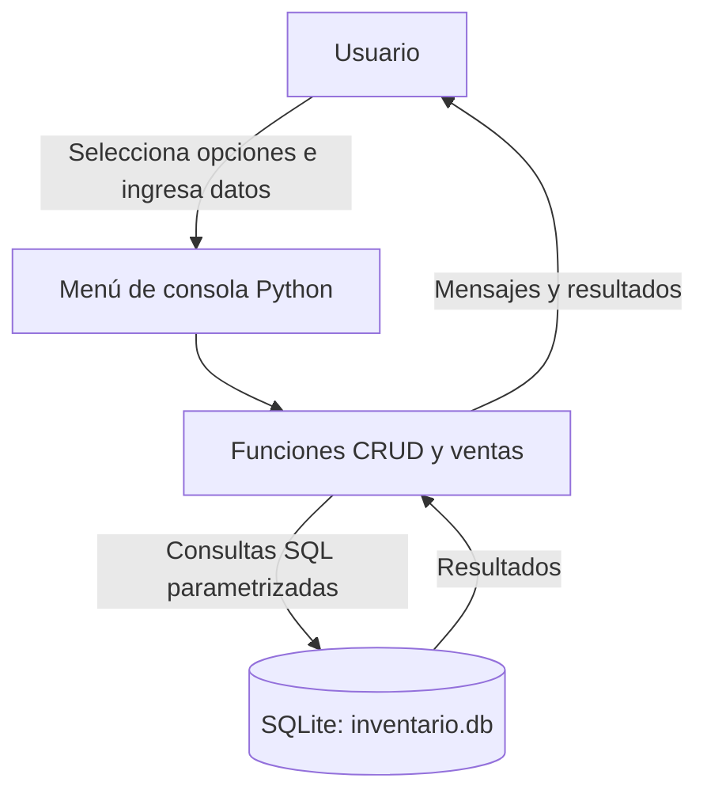

# Sistema de inventario y ventas

**Asignatura:** Acceso a Datos  
**Tecnologías:** Python 3, `sqlite3`, SQLite  
**Tipo:** Aplicación de consola

## 1. Descripción

El sistema permite registrar y consultar productos, actualizar precios o existencias, eliminar productos cuando no tienen ventas asociadas, registrar ventas y consultar el historial con el nombre del producto mediante `INNER JOIN`.

La base de datos `inventario.db` y sus tablas se crean automáticamente al iniciar el programa.

## 2. Requisitos

- Python 3.10 o superior (también puede funcionar con versiones anteriores que incluyan `sqlite3`).
- No necesita instalar paquetes externos.

## 3. Ejecución

1. Descarga o clona este repositorio.
2. Abre una terminal en la carpeta del proyecto.
3. Ejecuta:

   ```bash
   python main.py
   ```

   En algunos equipos Windows el comando puede ser `py main.py`.

4. Usa el menú para registrar productos y realizar pruebas.
5. Para demostrar la transacción, registra un producto con existencia mayor que cero y selecciona la opción **7. Demostrar rollback()**.

## 4. Análisis del software

La aplicación está organizada en funciones: conexión y creación de tablas, operaciones CRUD, registro de ventas, historial y prueba de rollback. Se usa `sqlite3` para acceder a la base de datos local. Las consultas reciben parámetros mediante `?` para evitar concatenar datos introducidos por el usuario.

### Entidades y atributos

**Producto**
- `id`: clave primaria autoincremental.
- `nombre`: nombre único y obligatorio.
- `precio`: precio unitario, no negativo.
- `cantidad`: existencias disponibles, no negativas.

**Venta**
- `id`: clave primaria autoincremental.
- `producto_id`: clave foránea que referencia a `productos.id`.
- `cantidad`: unidades vendidas, mayor que cero.
- `precio_unitario`: precio del producto al momento de la venta.
- `total`: precio unitario multiplicado por cantidad.
- `fecha`: fecha y hora del registro.

### Modelo relacional

```text
PRODUCTOS (1) ─────────── (N) VENTAS

productos.id  PK  <────── ventas.producto_id  FK
productos.nombre
productos.precio
productos.cantidad

ventas.id  PK
ventas.cantidad
ventas.precio_unitario
ventas.total
ventas.fecha
```

Un producto puede aparecer en muchas ventas; cada venta pertenece a un solo producto. La relación usa `ON DELETE RESTRICT` para proteger el historial.

### Arquitectura



## 5. Operaciones de una venta

1. Iniciar una transacción con `BEGIN IMMEDIATE`.
2. Consultar el producto por su ID.
3. Verificar que exista y que tenga suficientes unidades.
4. Insertar la venta con el precio vigente y el total.
5. Descontar las unidades del inventario.
6. Ejecutar `commit()` para confirmar ambos cambios.
7. Si ocurre un error, ejecutar `rollback()` para deshacer todos los cambios de esa transacción.

### ¿Cómo se demuestra rollback()?

La opción 7 guarda los valores de inventario y número de ventas, inserta temporalmente una venta y provoca una excepción controlada antes de actualizar el inventario. El bloque de manejo ejecuta `rollback()`. Después se vuelven a consultar los datos y se comparan con los valores iniciales. Si son iguales, la prueba informa que los datos permanecieron intactos.

## 6. CRUD implementado

| Operación | SQL utilizado |
|---|---|
| Crear producto | `INSERT` |
| Consultar productos | `SELECT` |
| Actualizar precio/cantidad | `UPDATE` |
| Eliminar producto | `DELETE`, protegido por clave foránea |
| Registrar venta | `INSERT` + `UPDATE` en una transacción |
| Consultar historial | `SELECT` con `INNER JOIN` |

## 7. Evidencias para la entrega

Ejecuta el programa y toma pantallazos reales que muestren:

1. Menú inicial.
2. Registro y consulta de un producto.
3. Actualización de precio o cantidad.
4. Venta exitosa y existencias descontadas.
5. Historial de ventas con nombre del producto.
6. Intento de eliminar un producto que ya tiene ventas, si el programa muestra el mensaje de protección.
7. Opción 7: valores antes y después de rollback(), con el mensaje `PRUEBA EXITOSA`.

Guarda las imágenes en una carpeta `evidencias/` antes de subir el repositorio. No uses capturas inventadas: deben salir de tu ejecución.

## 8. Estructura del repositorio

```text
sistema-inventario-ventas/
├── main.py
├── README.md
├── modelo_datos.sql
├── .gitignore
└── evidencias/
    └── (agrega aquí tus pantallazos)
```

## 9. Conclusión

El sistema permite administrar productos y ventas con persistencia en SQLite. La relación entre las tablas conserva la integridad referencial y la transacción garantiza que el registro de una venta y el descuento del inventario se confirmen juntos o se cancelen juntos.
